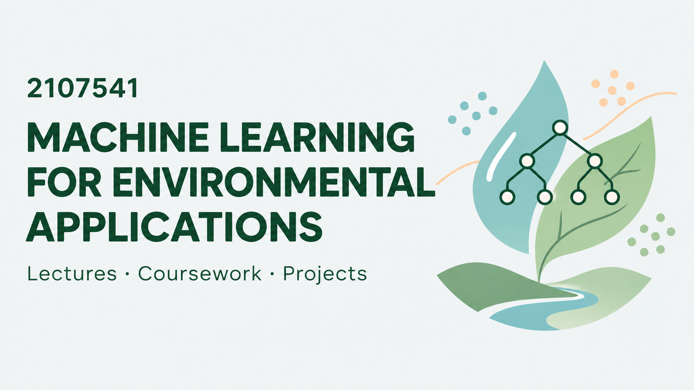

# 2107541 Machine Learning for Environmental Application
 

Section 1, Semester 2026/1
Instructor: Dr. Thitiwut Maliwan, Department of Environmental Engineering, Chulalongkorn University

## Syllabus
**Course description:** Fundamental concepts of machine learning and its applications in environmental engineering and sustainability.

**Learning objectives:** By the end of the course, students will be able to:
- Explain the fundamental concepts of machine learning and its applications in environmental engineering and sustainability.
- Select and apply supervised learning techniques (classification and regression) suited to environmental datasets.
- Select and apply unsupervised learning techniques (clustering and dimensionality reduction).
- Apply machine learning to analyze, predict, and support decision-making in environmental engineering and sustainability.

## Course Content
- Introduction to Machine Learning
- Supervised Learning: Decision Tree, Naive Bayes, Logistic Regression, SVM, kNN
- Data Preparation & Feature Engineering, Regression
- Model Evaluation (Classification & Regression)
- Ensemble Learning
- Unsupervised Learning: Clustering (K-means, Hierarchical, DBSCAN), Cluster Validation
- Feature Selection & Explainable ML
- Dimensionality Reduction (PCA, t-SNE)
- Time-series Analysis (ARIMA, Prophet, ML Forecasting)

## Schedule
Class time: Wednesday, 13:00–16:00

| Week | Date | Topic | Materials |
|---|---|---|---|
| 1 | 5 Aug 2026 | Introduction to Machine Learning | - |
| 2 | 12 Aug 2026 | Holiday (Mother's Day) | - |
| 3 | 19 Aug 2026 | Supervised Learning: Decision Tree, Naive Bayes | [Lecture 2](https://github.com/Chatrphol-Chula-Coursework/2107541_Machine_Learning_For_Environmental_Applications/tree/main/Lecture%202%20Decision%20Tree%20%26%20Naive%20Bayes) |
| 4 | 26 Aug 2026 | Supervised Learning: Logistic Regression, SVM | [Lecture 3](https://github.com/Chatrphol-Chula-Coursework/2107541_Machine_Learning_For_Environmental_Applications/tree/main/Lecture%203%20Logistic%20Regression%20%26%20Support%20Vector%20Machine) |
| 5 | 2 Sep 2026 | Supervised Learning: kNN, Model Evaluation | [Lecture 4](https://github.com/Chatrphol-Chula-Coursework/2107541_Machine_Learning_For_Environmental_Applications/tree/main/Lecture%204%20KNN%20%26%20Model%20Evaluation) |
| 6 | 9 Sep 2026 | Data Preparation & Feature Engineering, Regression | [Lecture 5](https://github.com/Chatrphol-Chula-Coursework/2107541_Machine_Learning_For_Environmental_Applications/tree/main/Lecture%205%20Linear%20Regression%20I) |
| 7 | 16 Sep 2026 | Regularized Regression, Model Evaluation | [Lecture 6](https://github.com/Chatrphol-Chula-Coursework/2107541_Machine_Learning_For_Environmental_Applications/tree/main/Lecture%206%20Linear%20Regression%20II%20%26%20Model%20Evaluation) |
| 8 | 30 Sep 2026 | Holiday (Commencement Ceremony) | - |
| 9 | 7 Oct 2026 | Ensemble Learning | [Lecture 7](https://github.com/Chatrphol-Chula-Coursework/2107541_Machine_Learning_For_Environmental_Applications/tree/main/Lecture%207%20Ensemble%20Learning) |
| 10–11 | 14 & 21 Oct 2026 | Clustering: K-means, Hierarchical, DBSCAN, Cluster Validation | [Lecture 8](https://github.com/Chatrphol-Chula-Coursework/2107541_Machine_Learning_For_Environmental_Applications/tree/main/Lecture%208%20Clustering) |
| 12 | 28 Oct 2026 | Feature Selection & Explainable ML | - |
| 13 | 4 Nov 2026 | Dimensionality Reduction: PCA, t-SNE | - |
| 14 | 11 Nov 2026 | Time-series Analysis: Forecasting | - |
| 15 | 18 Nov 2026 | Time-series: ARIMA, Prophet, ML Forecasting | - |

## Assignments
- [Homework 1: Classification Models for Water Quality and Potability](https://github.com/Chatrphol-Chula-Coursework/2107541_Machine_Learning_For_Environmental_Applications/tree/main/Homework%201%20Classification%20Models%20for%20Water%20Quality%20and%20Potability)
- [Quiz 1](https://github.com/Chatrphol-Chula-Coursework/2107541_Machine_Learning_For_Environmental_Applications/tree/main/Quiz%202107541%20ML%20Envi)
- [Final Project: Predicting Water Turbidity with TSS](https://github.com/NuBFightForMyDream/2107541_MLEnvi_Project_PredictingWaterTurbidityWithTSS)